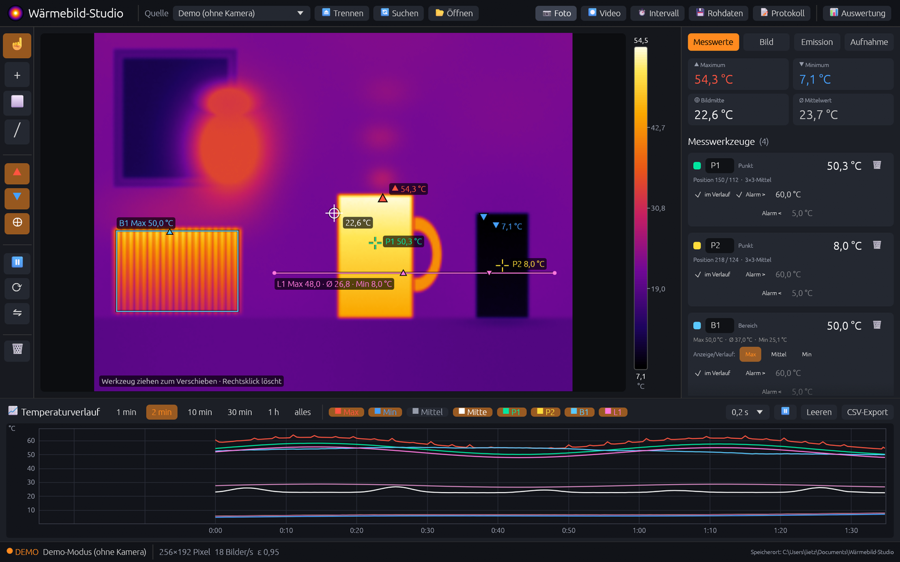

# Wärmebild-Studio

Desktop-Programm für Windows, das mit USB-Wärmebildkameras der TC001-Klasse (256 × 192 Pixel)
arbeitet. Es zeigt das Live-Bild, misst Temperaturen, zeichnet sie auf und wertet gespeicherte
Aufnahmen später neu aus. Die Oberfläche ist auf Deutsch.



> Unabhängiges Projekt, nicht von TOPDON oder einem anderen Kamerahersteller.
> Ohne angeschlossene Kamera startet das Programm mit einer Demo-Szene.

## Funktionen

**Live-Bild**
- 8 Farbpaletten, automatischer oder fester Temperaturbereich, Isotherme
- heißester und kältester Punkt sowie die Bildmitte werden automatisch markiert
- Drehen, Spiegeln, Rauschfilter
- Emissionsgrad (mit Material-Liste), reflektierte Temperatur, Lufttemperatur, Entfernung,
  Luftfeuchte und Offset

**Messen**
- beliebig viele Messpunkte, Messbereiche und Messlinien, jeweils mit Alarmgrenzen
- Messbereiche als Rechteck, Kreis oder Polygon (Auswahl per langem Klick oder Rechtsklick
  auf das Bereichs-Symbol)
- bei Bereichen und Linien Max, Mittel und Min einzeln oder gleichzeitig anzeigen
- Temperaturverlauf als Kurve, Export als CSV (Datum/Uhrzeit auf die Millisekunde und
  vergangene Millisekunden)

**Aufnehmen**
- Foto, Intervall-Fotos, Video (AVI/MJPEG)
- Bilder werden beschriftet: Messwerte an den Werkzeugen, Farbskala mit Temperaturen,
  Datum/Uhrzeit und Max/Min/Mitte (einzeln abschaltbar)
- Rohdaten-Aufzeichnung (`.tcraw`) und Temperatur-Tabelle pro Bild (`.csv`)
- fortlaufendes Temperatur-Protokoll als CSV

**Netzwerk-Stream**
- eingebauter Webserver: Live-Bild mit Beschriftung und aktuelle Messwerte im Browser,
  auf jedem Gerät im selben Netz (oder nur auf diesem PC)
- `/stream.mjpg` für VLC oder OBS, `/bild.jpg` als Einzelbild, `/werte.json` für eigene Auswertungen
- Port, Bildgröße und Bilder pro Sekunde einstellbar; das Ansehen geht ohne Passwort, daher
  nur in vertrauenswürdigen Netzen verwenden
- **Fernsteuerung** unter `/steuerung`, geschützt durch ein Passwort, das im Programm gesetzt
  wird: Palette, Temperaturbereich, Isotherme, Darstellung, Emissionswerte, Messwerkzeuge
  setzen (Klick bzw. Ziehen ins Bild), ändern und löschen, Foto, Intervall, Video, Rohdaten
  und Protokoll starten. Die Übertragung ist unverschlüsseltes HTTP; das Passwort wird nicht
  gespeichert

**CAN-Bus**
- Messwerte zyklisch auf den CAN-Bus senden (PEAK PCAN-USB, benötigt den PEAK-Treiber
  mit PCAN-Basic), z. B. um sie synchron mit Fahrzeug-Messdaten aufzuzeichnen
- Kanal, Baudrate (5 kBit/s – 1 MBit/s), Basis-ID, Standard-/Extended-ID und Zykluszeit einstellbar
- Belegung: je Botschaft vier Werte, signed 16 Bit, Intel, Faktor 0,1 °C; zuerst Max/Min/Mitte/
  Mittel des Bildes, dann jedes Messwerkzeug (Bereiche und Linien mit Max, Mittel, Min);
  `0x8000` = kein Wert
- Export der passenden DBC-Datei

**Auswerten**
- Fotos, Rohdaten-Aufnahmen, ganze Intervall-Serien und CSV-Tabellen öffnen
  (auch per Ziehen ins Fenster)
- Emissionswerte, Palette und Messwerkzeuge nachträglich ändern, die Temperaturen
  werden neu berechnet
- Temperaturverlauf über die ganze Serie oder Aufnahme; Klick in die Kurve springt zum Bild
- Histogramm und Bereichsanalyse

## Herunterladen

Die fertige `waermebild-studio.exe` gibt es unter **Releases**. Sie läuft ohne Installation:
herunterladen und doppelklicken. Sie wird auf GitHub aus diesem Quellcode gebaut
(siehe [Code-Signierung](#code-signierung--code-signing-policy)).

## Kamera

Unterstützt werden Kameras, die sich als USB-Videogerät (UVC) melden und ein Bild aus
Wärmebild- und Temperaturhälfte liefern (256 × 384), z. B. die TOPDON TC001. Das Programm
findet sie über den Windows-Kameratreiber oder direkt per USB (für Geräte mit
libusbK/WinUSB-Treiber).

## Selbst bauen

Benötigt wird [Rust](https://rustup.rs). Mit der MSVC-Toolchain (Visual Studio Build Tools):

```
cargo build --release
```

Mit der GNU-Toolchain ohne Visual Studio braucht rustc ein vollständiges `dlltool`, z. B. aus
[WinLibs](https://winlibs.com). Dafür im Projekt eine Datei `.cargo/config.toml` anlegen:

```toml
[target.x86_64-pc-windows-gnu]
rustflags = ["-C", "dlltool=C:/Pfad/zu/mingw64/bin/dlltool.exe"]
```

Das Programm liegt danach unter `target/release/waermebild-studio.exe`.

## Dateiformate

- **`.tcraw`**: Kopf mit `TCRAW001`, Breite und Höhe (je u32, little-endian), 8 Byte reserviert;
  danach je Bild die Zeit in ms (f64) und die Rohwerte (u16, Kelvin × 64)
- **Temperatur-Tabelle `.csv`**: eine Zeile pro Bildzeile, Werte in °C nach allen Korrekturen

## Datenschutz

Das Programm sendet keine Daten an andere Rechner im Netzwerk oder im Internet, außer der
Benutzer richtet das ausdrücklich ein: Der Netzwerk-Stream (eingebauter Webserver) und die
Ausgabe auf den CAN-Bus sind standardmäßig aus und werden nur im Programm eingeschaltet.
Es gibt keine Telemetrie und keine Update-Prüfung.

## Code-Signierung / Code signing policy

Free code signing provided by [SignPath.io](https://about.signpath.io/), certificate by
[SignPath Foundation](https://signpath.org/).

Kostenlose Code-Signierung durch SignPath.io, Zertifikat von der SignPath Foundation.
Signiert werden nur Programmdateien, die von GitHub Actions aus diesem Repository gebaut
wurden ([Release-Workflow](.github/workflows/release.yml)); jede Signierung wird von Hand
freigegeben.

**Team / Rollen**

- Committer und Reviewer: [kapalabathi](https://github.com/kapalabathi)
- Approver: [kapalabathi](https://github.com/kapalabathi)

**Datenschutz / Privacy:** This program will not transfer any information to other networked
systems unless specifically requested by the user or the person installing or operating it
(siehe [Datenschutz](#datenschutz)).

## Lizenz

[MIT](LICENSE). Mitgelieferte Bibliotheken stehen unter eigenen Open-Source-Lizenzen,
u. a. libusb (LGPL-2.1).
